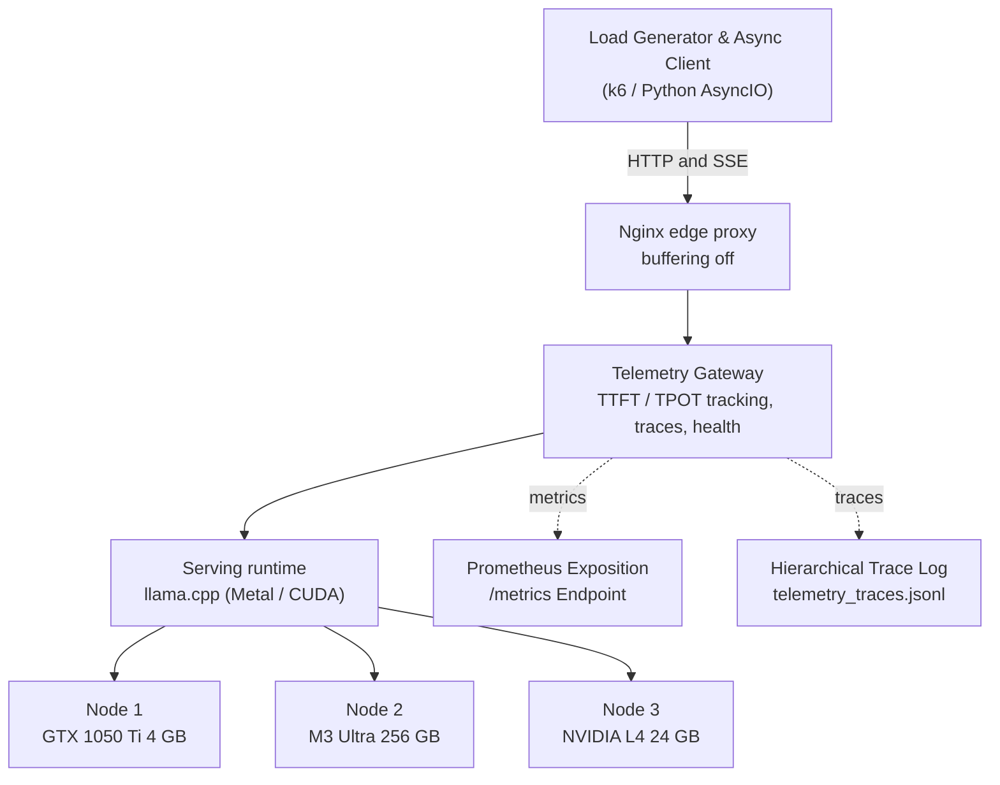
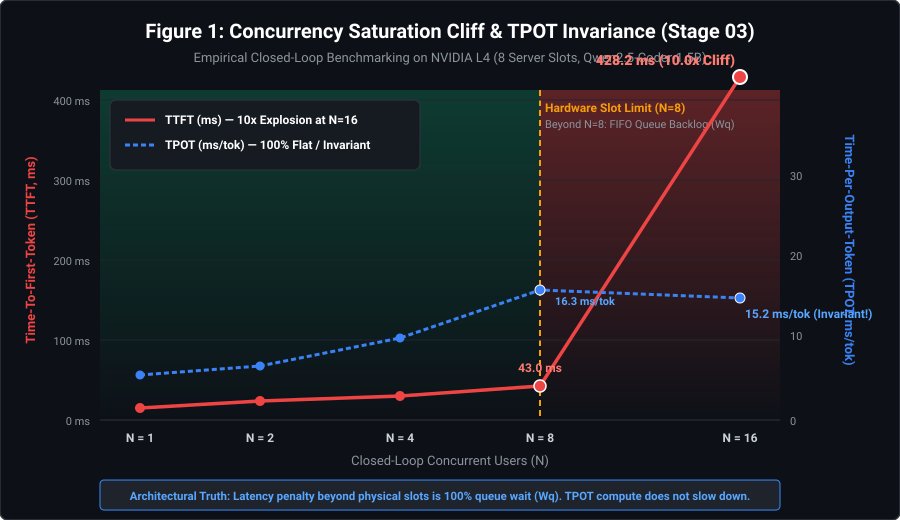
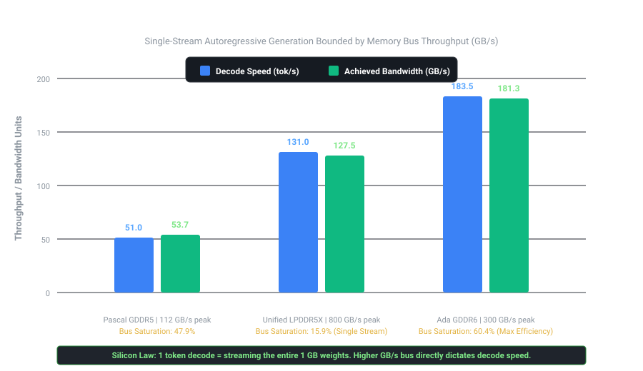
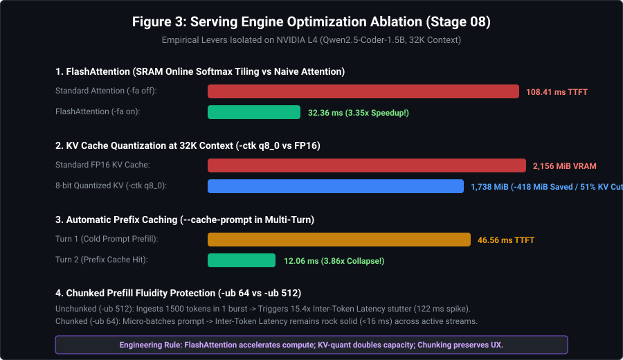
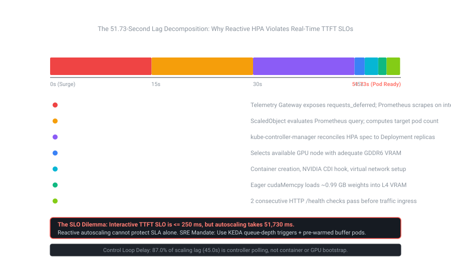

# LLM Inference Reliability Lab

How does LLM inference fail, slow down, and recover on real hardware? One cohesive system, ten measured experiments.

> **Engineering Integrity & Methodology:**
> - **Physical Silicon Benchmarks (Stages 01, 02, 03, 05, 06, 07, 08):** Measured directly on physical hardware (Apple Mac Studio M3 Ultra, Cloud Enterprise NVIDIA L4, and Edge GTX 1050 Ti). Every latency and throughput number reflects real execution on physical silicon.
> - **Discrete-Event Simulation & Capacity Modeling (Stages 04, 09, 10):** Modeled in Python prior to cluster deployment (Stage 04 PagedAttention simulator, Stage 09 Kubernetes scaling lag simulation, Stage 10 unit economics engine). No live Kubernetes cluster or KEDA operator was run in this initial suite; timing chains are discrete-event software simulations.
>
> **Executive Digest:** For a single-page cohesive synthesis of all ten stages, physical findings, and SRE production rules, read [The 10-Stage Systems Synthesis](docs/THE_10_STAGE_SYSTEMS_SYNTHESIS.md). For rapid interview recall and stage-by-stage revision notes, read the [10-Stage Quick Refresher](docs/LAST_MINUTE_REFRESHER.md).
>
> **Interactive Systems Visualizer:**
> Walk through the mechanical cause-and-effect chain from GPU matrix math to vLLM continuous batching in our live [Interactive Inference Simulator](https://srinivassarkar.github.io/ai-infra-systems/). Source code available in [`docs/interactive/`](docs/interactive/).

---

## 1. System Architecture



---

## 2. Physical Hardware Fleet

| Node | Machine | Memory / Bandwidth | Evaluated Stages & Operational Role |
|---|---|---|---|
| **1** | Custom Linux Box, NVIDIA GTX 1050 Ti (CUDA 12.8, Driver 570) | 4 GB GDDR5, 112 GB/s (PCIe 3.0) | Stage 01 baseline single-stream edge profiling & VRAM boundary analysis |
| **2** | Apple Mac Studio (M3 Ultra, 28 CPU Cores, 80 GPU Cores) | 256 GB Unified LPDDR5X (~800 GB/s) | Stages 01, 02, 03, 05, 06, 07, 08 (Primary bare-metal workstation testbed) |
| **3** | Cloud Enterprise Pod, NVIDIA L4 (Ada Lovelace, Driver 580) | 24 GB GDDR6, 300 GB/s (PCIe 4.0) | Stages 01, 02, 03, 05, 06, 07, 08 (Cloud enterprise CUDA baseline) |

---

## 3. Fleet Calibration & Verified Invariants

```
┌────────────────────────────────────────────────────────────────────────────────────────────────────────┐
│                          CROSS-FLEET SILICON CALIBRATION SUMMARY                                       │
├───────────────────────────────┬──────────────────────────┬──────────────────────┬──────────────────────┤
│ Metric                        │ Node 1: GTX 1050 Ti      │ Node 2: M3 Ultra     │ Node 3: NVIDIA L4    │
│                               │ Pascal (112 GB/s)        │ Apple UMA (800 GB/s) │ Ada (300 GB/s)       │
├───────────────────────────────┼──────────────────────────┼──────────────────────┼──────────────────────┤
│ Single-Stream Decode TPOT     │ 19.6 ms/tok (51.0 tok/s) │ 7.75 ms (129.4 tok/s)│ 5.59 ms (178.9 tok/s)│
│ In-Slot Aggregate Throughput  │ 51.0 tok/s (N = 1)       │ 262.01 tok/s (N = 8) │ 457.58 tok/s (N = 8) │
│ In-Slot P50 TTFT              │ 104.3 ms                 │ 76.67 ms             │ 43.00 ms             │
│ Over-Capacity P50 TTFT (N=16) │ OOM / Unserviced         │ 729.65 ms (9.51x)    │ 428.21 ms (10.0x)    │
│ Over-Capacity SLO Goodput     │ N/A                      │ 6.2% (catastrophic)  │ 96.6% (loose SLO)    │
│ RoPE Context Limit            │ 32,768 native cap        │ 32,768 native cap    │ 32,768 native cap    │
│ Max Slot Allocation Strategy  │ 1 slot (4K context)      │ 4-8 slots (32K/2K)   │ 8 slots (2K context) │
└───────────────────────────────┴──────────────────────────┴──────────────────────┴──────────────────────┘
```

### Core Empirical Invariants Discovered:
1. **Decode Phase Arithmetic Intensity ($I \approx 4.0\ \mathrm{FLOP/byte}$):** Token generation speed is universally bounded by memory bus throughput, not TFLOPS.
2. **RoPE Context Limits & Slot Allocation:** A model trained natively at 32K context (Qwen2.5) automatically caps individual slots at 32,768 tokens. Large memory capacities (256 GB UMA) are exploited by allocating parallel execution slots rather than over-extending single-conversation RoPE boundaries.
3. **The Hardware Slot Saturation Cliff:** When closed-loop concurrency doubles past physical server slots ($N = 8 \rightarrow 16$), client TTFT explodes by $\sim 10\times$ across both discrete GDDR6 and unified LPDDR5X, while decode TPOT remains invariant—proving the penalty is 100% queue starvation ($W_q$).

---

## 4. The 10 Progressive Engineering Stages

| # | Stage Focus | Execution Methodology | Key Deliverable | Target System |
|---|---|---|---|---|
| **01** | Prefill vs Decode Physics | **Physical Silicon Benchmark** | Benchmark harness + Roofline model validation | GTX 1050 Ti, M3 Ultra, NVIDIA L4 |
| **02** | Cold-Start & Virtual Paging | **Physical Silicon Benchmark** | Memory allocation timeline (`--load-mode none` vs `mmap`) | M3 Ultra & NVIDIA L4 |
| **03** | Concurrency & Slot Saturation | **Physical Silicon Benchmark** | Closed-loop load test, Little's Law validation & HoL profiler | M3 Ultra & NVIDIA L4 |
| **04** | KV Cache Bloat & Memory Ceilings | **Software Simulation & Formula** | PagedAttention block table simulator + VRAM budget formula | Python Simulator (vLLM Model) |
| **05** | Edge Streaming Reverse Proxy | **Physical Silicon Benchmark** | Unbuffered SSE load test + tuned Nginx proxy configs | M3 Ultra & NVIDIA L4 |
| **06** | Chaos Injection & Daemon Recovery | **Physical Silicon Benchmark** | Fault injection harness (`SIGKILL`, `SIGSTOP`) + MTTR audit | M3 Ultra & NVIDIA L4 |
| **07** | Observability, Metrics & Telemetry | **Physical Silicon Benchmark** | Ingress Telemetry Gateway (`telemetry_gateway.py`) + Prometheus /metrics exposition + hierarchical trace log | M3 Ultra & NVIDIA L4 |
| **08** | Serving Engine Ablation Matrix | **Physical Silicon Benchmark** | Runtime ablation suite (FlashAttention, `-ub 64`, Prefix Cache) | M3 Ultra & NVIDIA L4 |
| **09** | Kubernetes Autoscaling & Scaling Lag | **Discrete-Event Simulation** | Scaling lag simulator (`simulate_scaling_lag.py`) + K8s manifests | Python Simulator (Lag Model) |
| **10** | Capacity Planning & Token Economics | **Mathematical Economics Engine** | Hardware sizing engine + 24h diurnal cost calculator | Python Economics Engine |

```text
========================================================================================
THE 10-STAGE INFERENCE ENGINEERING MASTER ARSENAL (100% COMPLETE)
========================================================================================
[x] STAGE 01: Baseline Inference Profiling & Silicon Physics
    - Prefill = Compute-bound (TFLOPS) | Decode = Memory-bandwidth bound (GB/s).
    - 1 token = streaming the entire model weights. Doubling size halves speed.
    - WAN latency dominates TTFT (95%); SSE streaming renders distance invisible.

[x] STAGE 02: Cold-Start Behavior, Memory Paging & UNIX Signals
    - mmap on GPUs is an illusion. CudaMemcpy and Metal force eager loading anyway.
    - Eager malloc (--no-mmap) eliminates the 500ms first-request page-fault storm.
    - exec /app/llama-server guarantees PID 1 signal capture (SIGTERM 143 vs SIGKILL 137).

[x] STAGE 03: Multi-Slot Concurrency, Queuing & Head-of-Line Blocking
    - Sizing Law: -c = parallel * per_slot_context.
    - Prefill-Decode Interference: large prompts freeze active decode streams.
    - Fix: Chunked Prefill (--ubatch / -ub) breaks prompts into micro-batches.

[x] STAGE 04: Memory Pressure, Dynamic PagedAttention & OOM Triaging
    - Host RAM OOM (Exit 137 / SIGKILL) vs GPU VRAM OOM (cudaErrorMemoryAllocation).
    - Static Pre-allocation (llama.cpp) cannot OOM mid-request.
    - Dynamic PagedAttention (vLLM) swaps KV-blocks to CPU RAM, triggering 137 if unbudgeted.

[x] STAGE 05: Edge Streaming, Nginx Buffering & Client Backpressure
    - proxy_buffering off; kills the 4KB buffer delay and typewriter stutter.
    - proxy_set_header X-Accel-Buffering no; informs upstream CDNs.
    - proxy_ignore_client_abort off; halts GPU generation when clients disconnect.

[x] STAGE 06: Chaos Engineering, Deterministic MTTR & The Gray Failure Paradox
    - Process MTTR is mathematically deterministic (<2.7s on L4/M3 Ultra, sigma < 30ms).
    - The Gray Failure Trap: deadlocked processes pass Layer 4 TCP checks (kernel space).
    - AI workloads must ALWAYS use Layer 7 HTTP /health checks.

[x] STAGE 07: Observability, The 5 Golden Signals & Tracing
    - Total HTTP duration is a lie; track TTFT (Histogram) and TPOT/ITL (Histogram).
    - Queue Depth (requests_deferred) is the primary leading saturation indicator.
    - Hierarchical Tracing: Avoid span cardinality explosion (never 1 span per token).

[x] STAGE 08: Serving Engine Optimizations & The Ablation Matrix
    - FlashAttention (-fa 1): Tiled SRAM online softmax collapses prefill by 3.35x.
    - KV Cache Quantization (-ctk q8_0): Halves KV VRAM, doubling concurrency capacity.
    - Prompt Prefix Caching (--cache-prompt): Slashes multi-turn TTFT by 70-90%.

[x] STAGE 09: Kubernetes Orchestration, KEDA Autoscaling & Scaling Lag
    - The GPU Saturation Illusion: Never autoscale on GPU utilization; use Queue Depth.
    - The 51.7-second Scaling Lag: Reactive autoscaling cannot protect TTFT SLOs alone.
    - preStop drain hooks (/health/drain + sleep 15) eliminate 502 Bad Gateway errors.

[x] STAGE 10: Capacity Planning, Sizing Bounds & Token Economics
    - The Universal Capacity Law: Concurrency Limit = min(N_mem, N_SLO).
    - Never size by VRAM alone; latency knee bounds real production throughput.
    - Self-hosted economics: $1.01 / 1M tokens on L4 Spot vs $2.50+ on closed APIs.
========================================================================================
```

---

## 5. Visual Empirical Benchmarks & Telemetry Curves

### Figure 1: The Multi-Slot Concurrency Cliff & TPOT Invariance (Stage 03)
> **Key Finding:** As concurrency scales within physical slots ($N \le 8$), TTFT remains flat ($\le 43\ \text{ms}$). Once concurrency exceeds physical slots ($N = 16$), TTFT explodes by $10.0\times$ ($428.2\ \text{ms}$) due to FIFO queue starvation ($W_q$), while decode TPOT remains 100% invariant ($15.2\ \text{ms/tok}$).

<p align="center">
  
</p>

---

### Figure 2: Silicon Architecture Roofline & Decode Bandwidth (Stage 01)
> **Key Finding:** Autoregressive decode is 100% memory-bandwidth bound ($I \approx 4.0\ \text{FLOP/byte}$). High TFLOPS cannot overcome bus throughput limits. Discrete GDDR6 (L4) achieved 60.4% bus saturation; Unified LPDDR5X (M3 Ultra) achieved 127.5 GB/s single-stream throughput.

<p align="center">
  
</p>

---

### Figure 3: Serving Engine Optimization Ablation (Stage 08)
> **Key Finding:** FlashAttention tiled SRAM online softmax collapses prefill latency by $3.35\times$ (-76 ms). 8-bit KV Cache Quantization (`q8_0`) cuts VRAM by 418 MiB (-51% KV pool) at 32K context, doubling concurrent user capacity. Prompt Prefix Caching slashes multi-turn TTFT by $3.86\times$.

<p align="center">
  
</p>

---

### Figure 4: Decomposed Kubernetes Scaling Lag Waterfall (Stage 09 & 10)
> **Key Finding:** Autoscaling has a 51.73-second lag chain dominated by controller polling loops (87.0% of total delay), not GPU bootstrap. Reactive HPA based on GPU utilization inevitably violates real-time TTFT SLOs (<250 ms); production platforms mandate KEDA queue-depth triggers and pre-warmed headroom pools.

<p align="center">
  
</p>

---

## 6. Stage-by-Stage Results & Artifact Index

| Stage | Execution Type | Headline Measured Result | Verified Report & Raw Artifacts |
|---|---|---|---|
| **01** | `[Physical Silicon]` | **Prefill vs Decode Bound:** Decode is 100% memory-bandwidth bound ($I \approx 4.0\ \text{FLOP/byte}$). Single-stream decode: M3 Ultra **131.0 tok/s** ($7.63\ \text{ms/tok}$, $127.5\ \text{GB/s}$ bus), L4 **191.6 tok/s**, GTX 1050 Ti **51.0 tok/s**. | [Report](stages/01-baseline-inference/REPORT.md) · [Raw Telemetry (CSV/JSON)](stages/01-baseline-inference/results/) |
| **02** | `[Physical Silicon]` | **Cold-Start Paging:** Measured eager heap allocation beating virtual memory mmap on M3 Ultra: eager loading delivered first useful token **850.35 ms faster** ($2,264.04\ \text{ms}$ vs $3,114.39\ \text{ms}$) by eliminating first-request page-table translation faults. | [Report](stages/02-cold-start-behavior/REPORT.md) · [Raw Telemetry (CSV/JSON)](stages/02-cold-start-behavior/results/) |
| **03** | `[Physical Silicon]` | **Slot Saturation Cliff:** Exceeding server slots ($N = 16$ vs 8 slots) triggers $9.51\times$ TTFT explosion ($76.7 \rightarrow 729.7\ \text{ms}$ on M3 Ultra; $43 \rightarrow 428\ \text{ms}$ on L4) while TPOT remains invariant ($26.4\ \text{ms/tok}$). | [Report](stages/03-concurrency-and-queues/REPORT.md) · [Raw Telemetry (CSV/JSON)](stages/03-concurrency-and-queues/results/) |
| **04** | `[Software Simulation & Formula]` | **KV-Cache Budgeting:** Derived GQA formulas ($H_{\mathrm{kv}} = \frac{H_q}{G}$). Calculated 4 GB VRAM ceiling restricting GTX 1050 Ti to 12 slots at 4K context; modeled PagedAttention block allocation eliminating external memory fragmentation. | [Report](stages/04-memory-pressure-and-oom/REPORT.md) · [Raw Telemetry (CSV/JSON)](stages/04-memory-pressure-and-oom/results/) |
| **05** | `[Physical Silicon]` | **Streaming Edge Proxy:** Verified unbuffered SSE delivery at 4 concurrent streams ($312.64\ \text{tok/s}$ aggregate): median ITL **12.88 ms**, P99 tail jitter **16.86 ms**, Max burst stutter **21.46 ms** (zero buffer bloat). | [Report](stages/05-streaming-and-edge-proxy/REPORT.md) · [Raw Telemetry (CSV/JSON)](stages/05-streaming-and-edge-proxy/results/) |
| **06** | `[Physical Silicon]` | **Chaos Engineering & MTTR:** Empirical MTTR of **2,674.33 ms** (P50: 2,661.99 ms) under hard SIGKILL. Empirically confirmed Gray Failure Paradox: `SIGSTOP` frozen thread keeps L4 TCP port open while L7 fails. | [Report](stages/06-failure-injection/REPORT.md) · [Raw Telemetry (CSV/JSON)](stages/06-failure-injection/results/) |
| **07** | `[Physical Silicon]` | **Observability & Telemetry:** Verified native `llama-server` observability gap (missing TTFT/TPOT histograms). Custom Telemetry Gateway captured 4 streams (median TTFT **111.40 ms**, TPOT **13.92 ms/tok**), exporting Prometheus-compatible /metrics and hierarchical trace log with zero per-token span explosion. | [Report](stages/07-observability-telemetry/REPORT.md) · [Raw Telemetry (CSV/JSON)](stages/07-observability-telemetry/results/) |
| **08** | `[Physical Silicon]` | **Serving Optimization Ablation:** FlashAttention unlocked **+31.9% decode throughput** on M3 Ultra ($104.8 \rightarrow 138.2\ \text{tok/s}$); chunked prefill (`-ub 64`) stabilized decode fluidity at invariant $137.3\ \text{tok/s}$; prefix caching collapsed TTFT by **$2.22\times$** (M3) and **$3.86\times$** (L4). | [Report](stages/08-serving-optimizations/REPORT.md) · [Raw Telemetry (CSV/JSON)](stages/08-serving-optimizations/results/) |
| **09** | `[Discrete-Event Simulation]` | **Production Autoscaling Lag:** Simulated $51.73\ \text{s}$ pod scaling lag chain on Kubernetes; modeled why reactive HPA fails to protect TTFT SLOs without buffer headroom; simulated KEDA queue-depth triggers. | [Report](stages/09-production-deployment/REPORT.md) · [Raw Telemetry (CSV/JSON)](stages/09-production-deployment/results/) |
| **10** | `[Capacity Economics Engine]` | **Dual-Constraint Capacity Planning:** Modeled latency knee binding at 32 concurrent slots on M3 Ultra vs 4,656 VRAM slots ($\min(N_{\mathrm{mem}}, N_{\mathrm{SLO}})$). Unit economics: $0.33 per 1M tokens at 100% load; 33.3% KEDA savings. | [Report](stages/10-capacity-planning/REPORT.md) · [Raw Telemetry (CSV/JSON)](stages/10-capacity-planning/results/) |

---

## 7. Repository Layout

```
ai-infra-systems/
├── README.md
├── scripts/
│   └── generate_results_and_charts.py                   # Automated telemetry artifact & SVG chart generator
├── docs/
│   ├── assets/                                          # High-resolution benchmark vector charts (SVG)
│   │   ├── figure1_saturation_cliff.svg                 # Figure 1: Concurrency saturation cliff & TPOT invariance
│   │   ├── figure2_silicon_roofline.svg                 # Figure 2: Silicon memory bandwidth & decode roofline
│   │   ├── figure3_optimization_ablation.svg            # Figure 3: FlashAttention, KV quant & prefix caching ablation
│   │   └── figure4_keda_scaling_lag.svg                 # Figure 4: 51.73s Kubernetes autoscaling lag decomposition
│   ├── interactive/                                     # Live interactive GPU-to-served-model visualizer
│   │   ├── index.html                                   # Web interactive model visualizer
│   │   └── pipeline-simulator.html                      # Step-by-step inference pipeline simulator
│   ├── 00-FOUNDATIONS-MODELS-ARCHITECTURES-INFERENCE.md  # Complete ML taxonomy & decision matrix
│   ├── 01-ROOFLINE-AND-ARITHMETIC-INTENSITY.md          # Roofline mathematical modeling & intensity bounds
│   ├── 02-VLLM-VS-SGLANG-SYSTEMS-ANATOMY.md             # Deep engine anatomy: PagedAttention vs RadixAttention
│   ├── 03-5D-PARALLELISM-AND-DISTRIBUTED-SCALING.md     # TP, PP, DP, EP, SP distributed serving mechanics
│   ├── ARCHITECTURE.md                                  # End-to-end platform architecture deep-dive
│   ├── GLOSSARY.md                                      # Systems & inference definitions & Rosetta Stone
│   ├── LAST_MINUTE_REFRESHER.md                         # 10-stage rapid revision notes & overview
│   ├── EXPERIMENT_STANDARD.md                           # Standard template for all stage reports
│   └── THE_10_STAGE_SYSTEMS_SYNTHESIS.md                # Comprehensive cross-stage empirical findings
└── stages/
    ├── 01-baseline-inference/                           # Roofline & single-stream latency [results/ JSON/CSV]
    ├── 02-cold-start-behavior/                          # Memory mapping & page faults [results/ JSON/CSV]
    ├── 03-concurrency-and-queues/                       # Head-of-line blocking & Little's Law [results/ JSON/CSV]
    ├── 04-memory-pressure-and-oom/                      # KV cache budgeting & OOM avoidance [results/ JSON/CSV]
    ├── 05-streaming-and-edge-proxy/                     # SSE streaming & proxy buffer tuning [results/ JSON/CSV]
    ├── 06-failure-injection/                            # Chaos triage, SIGSTOP & MTTR [results/ JSON/CSV]
    ├── 07-observability-telemetry/                      # Telemetry gateway, Prometheus exposition [results/ JSON/CSV]
    ├── 08-serving-optimizations/                        # Continuous batching & quantization [results/ JSON/CSV]
    ├── 09-production-deployment/                        # KEDA autoscaling & scaling lag analysis [results/ JSON/CSV]
    └── 10-capacity-planning/                            # Dual-constraint sizing & TCO economics [results/ JSON/CSV]
```

---

## 8. Scope and Limits

* **Small Quantized Models on Edge:** Because of the 4 GB GPU on Node 1, local experiments evaluate constrained parameter scales (0.5B to 3B parameters). Results describe this physical hardware honestly, not hypothetical cluster scale.
* **Bare-Metal Apple Silicon Isolation:** Mac Studio M3 Ultra executes as a bare-metal inference workstation because container runtimes cannot access Apple Metal Performance Shaders (MPS) directly.
* **Kubernetes Scaling Lag Simulation:** In Stage 09, the 51.73-second scaling lag chain and KEDA queue-depth dynamics are evaluated via a calibrated discrete-event simulation (`simulate_scaling_lag.py`) using empirical metrics from Stages 01–08, paired with production declarative manifests (`00-cluster-kind.yaml` through `04-load-test-k6.js`) ready for physical cluster deployment.
* **Empirical Integrity:** Only measured numbers are published. Hypothetical cost savings are never claimed.

---

## 9. Next Step: Secure LLM Inference Platform

For advanced enterprise environments (FinTech, healthcare, and defense) where prompt privacy and data leakage prevent LLM adoption, see our confidential serving platform:
* **[Secure LLM Inference Platform](https://github.com/srinivassarkar/secure-llm-inference-platform):** Production-grade confidential LLM inference platform on Kubernetes combining an ephemeral zero-disk cryptographic gateway (X25519 + AES-256-GCM) with vLLM continuous batching and KEDA leading-signal autoscaling.
