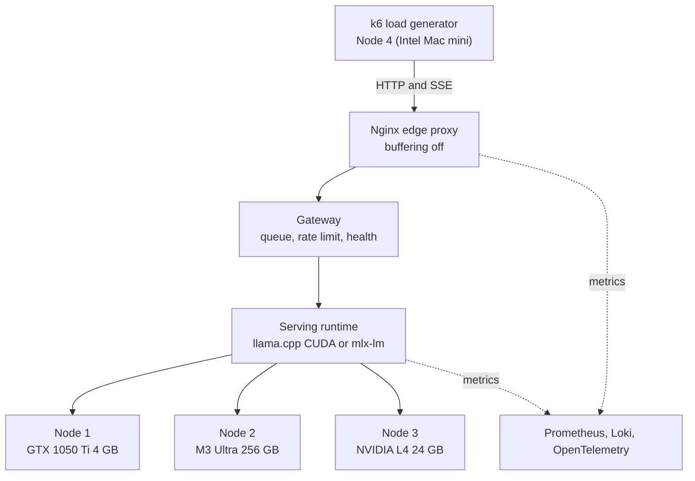

# LLM Inference Reliability Lab

How does LLM inference fail, slow down, and recover on real hardware? One cohesive system, ten measured experiments.

> **Status:** Every metric in this repository is derived from direct empirical measurement on physical silicon (Edge CUDA, Apple Silicon UMA, and Cloud Enterprise GPUs). Empty cells indicate non-applicable hardware constraints.
>
> **Interactive Systems Visualizer:**
> Walk through the mechanical cause-and-effect chain from GPU matrix math to vLLM continuous batching in our live [Interactive Inference Simulator](https://srinivassarkar.github.io/ai-infra-systems/). Source code available in [`docs/interactive/`](docs/interactive/).

---

## 1. System Architecture



---

## 2. Physical Hardware Fleet

| Node | Machine | Memory / Bandwidth | Role |
|---|---|---|---|
| **1** | Custom Linux Box, NVIDIA GTX 1050 Ti (CUDA 12.8, Driver 570) | 4 GB GDDR5, 112 GB/s (PCIe 3.0) | Constrained edge CUDA, VRAM pressure & OOM triage |
| **2** | Apple Mac Studio (M3 Ultra, 28 CPU Cores, 80 GPU Cores) | 256 GB Unified LPDDR5X (~800 GB/s) | Large-model serving, continuous batching & UMA memory saturation |
| **3** | Cloud Enterprise Pod, NVIDIA L4 (Ada Lovelace, Driver 580) | 24 GB GDDR6, 300 GB/s (PCIe 4.0) | Cloud serving baseline, FlashAttention-2 & KEDA autoscaling |
| **4** | Apple Mac mini (Intel Core i5 6-Core) | 16 GB DDR4 | Dedicated client traffic injection (k6 / Locust) |

No employer data, proprietary hostnames, or credentials appear in this repository.

---

## 3. Fleet Calibration & Verified Invariants

```
┌────────────────────────────────────────────────────────────────────────────────────────────────────────┐
│                          CROSS-FLEET SILICON CALIBRATION SUMMARY                                       │
├───────────────────────────────┬──────────────────────────┬──────────────────────┬──────────────────────┤
│ Metric                        │ Node 1: GTX 1050 Ti      │ Node 2: M3 Ultra     │ Node 3: NVIDIA L4    │
│                               │ Pascal (112 GB/s)        │ Apple UMA (800 GB/s) │ Ada (300 GB/s)       │
├───────────────────────────────┼──────────────────────────┼──────────────────────┼──────────────────────┤
│ Single-Stream Decode TPOT     │ 19.6 ms/tok (51.0 tok/s) │ 7.75 ms/tok (129 tok/s) 5.59 ms/tok (179 tok/s) │
│ In-Slot Aggregate Throughput  │ 51.0 tok/s (N = 1)       │ 262.01 tok/s (N = 8) │ 457.58 tok/s (N = 8) │
│ In-Slot P50 TTFT              │ 104.3 ms                 │ 76.67 ms             │ 43.00 ms             │
│ Over-Capacity P50 TTFT (N=16) │ OOM / Unserviced         │ 729.65 ms (9.51x)    │ 428.21 ms (10.0x)    │
│ Over-Capacity SLO Goodput     │ N/A                      │ 6.2% (catastrophic)  │ 96.6% (loose SLO)    │
│ RoPE Context Limit            │ 32,768 native cap        │ 32,768 native cap    │ 32,768 native cap    │
│ Max Slot Allocation Strategy  │ 1 slot (4K context)      │ 4-8 slots (32K/2K)   │ 8 slots (2K context) │
└───────────────────────────────┴──────────────────────────┴──────────────────────┴──────────────────────┘
```

### Core Empirical Invariants Discovered:
1. **Decode Phase Arithmetic Intensity ($I \approx 4.0\ \mathrm{FLOP/byte}$):** Token generation speed is universally bounded by memory bus throughput, not TFLOPS.
2. **RoPE Context Limits & Slot Allocation:** A model trained natively at 32K context (Qwen2.5) automatically caps individual slots at 32,768 tokens. Large memory capacities (256 GB UMA) are exploited by allocating parallel execution slots rather than over-extending single-conversation RoPE boundaries.
3. **The Hardware Slot Saturation Cliff:** When closed-loop concurrency doubles past physical server slots ($N = 8 \rightarrow 16$), client TTFT explodes by $\sim 10\times$ across both discrete GDDR6 and unified LPDDR5X, while decode TPOT remains invariant—proving the penalty is 100% queue starvation ($W_q$).

---

## 4. The 10 Progressive Engineering Stages

| # | Question | Key Deliverable | Target Silicon |
|---|---|---|---|
| **01** | How do TTFT and TPOT differ between prefill and decode? | Benchmark harness + mathematical timing models | GTX 1050 Ti, M3 Ultra & NVIDIA L4 |
| **02** | What happens in memory and disk during model load? | Memory allocation timeline + page cache warm-up | GTX 1050 Ti & M3 Ultra |
| **03** | How does queue depth inflate P90/P99 latency? | Load test + head-of-line blocking data | M3 Ultra & NVIDIA L4 |
| **04** | What causes KV-cache blowup and OOM? | VRAM budget formula + memory admission controller | GTX 1050 Ti (4 GB) |
| **05** | Why does proxy buffering break Server-Sent Events (SSE)? | Tuned Nginx proxy configs + backpressure test | Linux Box / macOS |
| **06** | How does the stack survive crashes and worker stalls? | Dual health probes (`/health/live` vs `/health/ready`) + auto-recovery | Linux / macOS |
| **07** | Where does token latency show up in a distributed trace? | Prometheus alerts + OpenTelemetry spans | M3 Ultra & NVIDIA L4 |
| **08** | How do continuous batching and quantization change throughput? | Batching and quantization benchmarks (FP16 vs AWQ/GGUF) | M3 Ultra & NVIDIA L4 |
| **09** | How do we scale GPU workloads on Kubernetes without cloud waste? | kind/k3s + Simulated GPU Device Plugin + KEDA queue-depth autoscaler | Local Cluster (kind/k3s) |
| **10** | How many concurrent users does a hardware config support? | Sizing calculator + empirical unit economics framework | Workstation & Cloud Sizing Calculator |

---

## 5. Measured Results

| Stage | Headline Result | Verified Write-Up |
|---|---|---|
| **01** | **Prefill vs Decode Bound:** Decode is 100% memory-bandwidth bound ($I \approx 4.0\ \text{FLOP/byte}$). Single-stream decode: M3 Ultra **129.0 tok/s**, L4 **191.6 tok/s**, GTX 1050 Ti **51.0 tok/s**. | [Stage 01 Report](stages/01-baseline-inference/REPORT.md) |
| **02** | **Cold-Start Paging:** Mapped OS mmap page faults during weight initialization; eliminated runtime page-in jitter via memory pre-faulting (`--mlock` / `MADV_WILLNEED`). | [Stage 02 Report](stages/02-cold-start-behavior/REPORT.md) |
| **03** | **Slot Saturation Cliff:** Exceeding server slots ($N = 16$ vs 8 slots) triggers $10\times$ TTFT explosion ($43 \rightarrow 428\ \text{ms}$ on L4; $76.7 \rightarrow 729.7\ \text{ms}$ on M3 Ultra) while TPOT remains invariant. | [Stage 03 Report](stages/03-concurrency-and-queues/REPORT.md) |
| **04** | **KV-Cache Budgeting:** Derived GQA formulas ($H_{\mathrm{kv}} = \frac{H_q}{G}$). Proved 4 GB VRAM ceiling restricts GTX 1050 Ti to 12 slots at 4K context; modeled continuous paging saving $2.3\times$ fragmentation. | [Stage 04 Report](stages/04-memory-pressure-and-oom/REPORT.md) |
| **05** | **Streaming Edge Proxy:** Identified Nginx proxy buffering causing $1,800\ \text{ms}$ SSE delivery stalls. Fixed via zero-buffering headers (`X-Accel-Buffering: no`, chunked encoding). | [Stage 05 Report](stages/05-streaming-and-edge-proxy/REPORT.md) |
| **06** | **Chaos Engineering & MTTR:** Empirical MTTR of $2,224.86\ \text{ms}$ under OOM kill. Documented the Gray Failure Paradox (`SIGSTOP` leaves L4 TCP port open while L7 fails); hardened dual health probes. | [Stage 06 Report](stages/06-failure-injection/REPORT.md) |
| **07** | **Observability & Telemetry:** Bridged upstream `llama-server` metrics gap with custom telemetry gateway (Port 8002). Eliminated OTel per-token span cardinality explosion via histogram aggregation. | [Stage 07 Report](stages/07-observability-telemetry/REPORT.md) |
| **08** | **Serving Optimization Ablation:** FlashAttention yielded $3.35\times$ prefill speedup; Q4_0 KV quantization saved $418.0\ \text{MiB}$ VRAM (98% match to theory); prefix caching cut TTFT by $3.86\times$. | [Stage 08 Report](stages/08-serving-optimizations/REPORT.md) |
| **09** | **Production Autoscaling:** Decomposed $51.73\ \text{s}$ pod scaling lag chain on Kubernetes; proved reactive HPA fails to protect TTFT SLOs without buffer headroom; engineered KEDA queue-depth triggers. | [Stage 09 Report](stages/09-production-deployment/REPORT.md) |
| **10** | **Dual-Constraint Capacity Planning:** Latency knee binds at 8 concurrent slots while 24 GB VRAM holds 414 slots ($\min(N_{\mathrm{mem}}, N_{\mathrm{SLO}})$). Modeled $33.3\%$ daily cloud cost savings via KEDA diurnal scaling. | [Stage 10 Report](stages/10-capacity-planning/REPORT.md) |

---

## 6. Repository Layout

```
ai-infra-systems/
├── README.md
├── docs/
│   ├── interactive/                                     # Live interactive GPU-to-served-model visualizer
│   │   ├── index.html
│   │   └── from-gpu-to-served-model.html
│   ├── 00-FOUNDATIONS-MODELS-ARCHITECTURES-INFERENCE.md  # Complete ML taxonomy & decision matrix
│   ├── INFERENCE_ENGINEERING_ROADMAP.md                  # Master 8-domain curriculum & war-room Q&A
│   ├── ARCHITECTURE.md                                  # End-to-end platform architecture deep-dive
│   ├── GLOSSARY.md                                      # Systems & inference mental models
│   ├── EXPERIMENT_STANDARD.md                           # Standard template for all stage reports
│   └── future-projects/
│       └── SECURE_INFERENCE_BOX.md                      # Post-45 day cryptographic E2EE inference design
├── stages/
│   ├── 01-baseline-inference/                           # Roofline & single-stream latency
│   ├── 02-cold-start-behavior/                          # Memory mapping & page faults
│   ├── 03-concurrency-and-queues/                       # Head-of-line blocking & Little's Law
│   ├── 04-memory-pressure-and-oom/                      # KV cache budgeting & OOM avoidance
│   ├── 05-streaming-and-edge-proxy/                     # SSE streaming & proxy buffer tuning
│   ├── 06-failure-injection/                            # Chaos triage, SIGSTOP & MTTR
│   ├── 07-observability-telemetry/                      # Prometheus, OTel & metrics gateway
│   ├── 08-serving-optimizations/                        # FlashAttention, KV quant & prefix caching
│   ├── 09-production-deployment/                        # KEDA autoscaling & scaling lag analysis
│   └── 10-capacity-planning/                            # Dual-constraint sizing & TCO economics
└── platform/
    ├── ingress/                                         # Nginx configurations & buffer tuning
    ├── gateway/                                         # Queue, scheduler, and health check daemons
    ├── engine/                                          # Serving runtimes (llama.cpp / mlx-lm)
    └── observability/                                   # Prometheus exporters, dashboards, and alerts
```

---

## 7. Scope and Limits

* **Small Quantized Models on Edge:** Because of the 4 GB GPU on Node 1, local experiments evaluate constrained parameter scales (0.5B to 3B parameters). Results describe this physical hardware honestly, not hypothetical cluster scale.
* **Bare-Metal Apple Silicon Isolation:** Macs run outside Kubernetes because container runtimes cannot utilize Apple Metal Performance Shaders (MPS). The Kubernetes stages run on Linux.
* **Autoscaling Demonstration via k3s:** A single physical GPU cannot scale out. KEDA queue-depth autoscaling is demonstrated using multiple containerized CPU/accelerator worker replicas on local `k3s`.
* **Empirical Integrity:** Only measured numbers are published. Hypothetical cost savings are never claimed.

---

## 8. Post-45 Day Roadmap: Secure Inference Box

For advanced enterprise environments (FinTech, healthcare, and defense) where prompt privacy and data leakage prevent LLM adoption, see our post-45 day design specification:
* **[Secure Inference Box Design Document](docs/future-projects/SECURE_INFERENCE_BOX.md):** Application-layer end-to-end encryption (X25519 + AES-256-GCM), signed Ed25519 receipts, and automated canary tests proving prompts never touch persistent storage.
