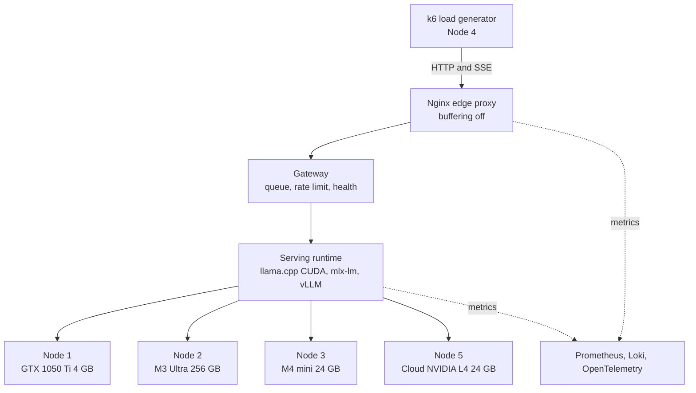

# LLM Inference Reliability Lab

How does LLM inference fail, slow down, and recover on real, modest hardware? One cohesive system, ten measured experiments.

> **Status:** in progress. Planned start Oct 26, 2026. Every number in this repository comes from a measured run on the hardware below. Empty cells in the results table mean "not measured yet".

---

## 1. System Architecture



---

## 2. Hardware Fleet

| Node | Machine | Memory | Role |
|---|---|---|---|
| **1** | Custom Linux Box, GTX 1050 Ti (CUDA 12.8, Driver 570) | 4 GB VRAM, 16 GB DDR4 | Constrained edge CUDA & OOM triage |
| **2** | Apple Mac Studio (M3 Ultra, 28 Cores) | 256 GB Unified LPDDR5X (~800 GB/s) | Large-model serving & memory bandwidth baseline |
| **3** | Apple Mac mini M4 (`Mac16,10`) | 24 GB Unified Memory | Edge serving workhorse |
| **4** | Apple Mac mini (Intel Core i5 6-Core) | 16 GB RAM | Dedicated client traffic injection (k6) |
| **5** | Cloud Instance (NVIDIA L4 24 GB, Ada Lovelace) | 24 GB GDDR6 | Dedicated Stage 08 production benchmark (vLLM vs llama.cpp) |

No employer data, proprietary hostnames, or credentials appear in this repository.

---

## 3. The 10 Progressive Engineering Stages

| # | Question | Key Deliverable | Target Silicon | Planned Dates |
|---|---|---|---|---|
| **01** | How do TTFT and TPOT differ between prefill and decode? | Benchmark harness + mathematical timing models | GTX 1050 Ti & M3 Ultra | Oct 26 – Oct 29 |
| **02** | What happens in memory and disk during model load? | Memory allocation timeline + page cache warm-up | GTX 1050 Ti & M3 Ultra | Oct 30 – Oct 31 |
| **03** | How does queue depth inflate P90/P99 latency? | Load test + head-of-line blocking data | Mac mini M4 + k6 Client | Nov 1 – Nov 5 |
| **05** | Why does proxy buffering break Server-Sent Events (SSE)? | Tuned Nginx proxy configs + backpressure test | Linux Box / macOS | Nov 6 – Nov 8 |
| **04** | What causes KV-cache blowup and OOM? | VRAM budget formula + memory admission controller | GTX 1050 Ti (4 GB) | Nov 9 – Nov 13 |
| **06** | How does the stack survive crashes and worker stalls? | Dual health probes (`/health/live` vs `/health/ready`) + auto-recovery | Linux / macOS | Nov 14 – Nov 18 |
| **07** | Where does token latency show up in a distributed trace? | Prometheus alerts + OpenTelemetry spans | M3 Ultra + Prometheus | Nov 19 – Nov 23 |
| **08** | How do continuous batching and quantization change throughput? | Empirical vLLM (PagedAttention + AWQ) vs llama.cpp; measured $/1M tokens | Cloud NVIDIA L4 (24 GB) | Nov 24 – Nov 28 |
| **09** | How is the stack deployed and supervised on Kubernetes? | systemd baseline, then k3s + KEDA queue-depth autoscaler | Local k3s Cluster | Nov 29 – Dec 3 |
| **10** | How many concurrent users does a hardware config support? | Sizing calculator + empirical unit economics framework | Workstation Calculator | Dec 4 – Dec 5 |

Serving runtimes are `llama.cpp` (CUDA, Node 1), `mlx-lm` (Apple Silicon, Nodes 2 & 3), and `vLLM` (NVIDIA L4, Node 5).

---

## 4. The Scientific Experiment Standard

Each stage folder (`stages/01-...` through `stages/10-...`) follows this strict empirical loop:

1. **Architecture:** Component diagram and request flow.
2. **Hypothesis:** Expected system behavior under specific conditions.
3. **Experiment:** Reproducible script injecting load or measuring hardware.
4. **Observed Output:** Raw metrics, telemetry tables, and latency percentiles.
5. **Root Cause Analysis:** Technical explanation of hardware, kernel, or software constraints.
6. **Remediation / Fix:** Production configuration, code change, or architecture fix.
7. **Verification:** Retest proving the issue is resolved.
8. **Engineering Write-up:** High-signal technical report.

---

## 5. Measured Results

| Stage | Headline Result | Verified Write-Up |
|---|---|---|
| **01** | *Runs starting Oct 26* | [Stage 01 Report](stages/01-baseline-inference/REPORT.md) |
| **02** | *Runs starting Oct 30* | [Stage 02 Report](stages/02-cold-start-behavior/README.md) |
| **03** | *Runs starting Nov 1* | [Stage 03 Report](stages/03-concurrency-and-queues/README.md) |
| **04** | *Runs starting Nov 9* | [Stage 04 Report](stages/04-memory-pressure-and-oom/README.md) |
| **05** | *Runs starting Nov 6* | [Stage 05 Report](stages/05-streaming-and-edge-proxy/README.md) |
| **06** | *Runs starting Nov 14* | [Stage 06 Report](stages/06-failure-injection/README.md) |
| **07** | *Runs starting Nov 19* | [Stage 07 Report](stages/07-observability-telemetry/README.md) |
| **08** | *Runs starting Nov 24* | [Stage 08 Report](stages/08-serving-optimizations/README.md) |
| **09** | *Runs starting Nov 29* | [Stage 09 Report](stages/09-production-deployment/README.md) |
| **10** | *Runs starting Dec 4* | [Stage 10 Report](stages/10-capacity-planning/README.md) |

---

## 6. Repository Layout

```
ai-infra-systems/
├── README.md
├── docs/
│   ├── 00-FOUNDATIONS-MODELS-ARCHITECTURES-INFERENCE.md  # Complete ML taxonomy & decision matrix
│   ├── INFERENCE_ENGINEERING_ROADMAP.md                  # Master 8-domain curriculum & war-room Q&A
│   ├── ARCHITECTURE.md                                  # End-to-end platform architecture deep-dive
│   ├── GLOSSARY.md                                      # Systems & inference mental models
│   ├── EXPERIMENT_STANDARD.md                           # Standard template for all stage reports
│   └── future-projects/
│       └── SECURE_INFERENCE_BOX.md                      # Post-45 day cryptographic E2EE inference design
├── stages/
│   ├── 01-baseline-inference/
│   ├── 02-cold-start-behavior/
│   ├── 03-concurrency-and-queues/
│   ├── 04-memory-pressure-and-oom/
│   ├── 05-streaming-and-edge-proxy/
│   ├── 06-failure-injection/
│   ├── 07-observability-telemetry/
│   ├── 08-serving-optimizations/
│   ├── 09-production-deployment/
│   └── 10-capacity-planning/
└── platform/
    ├── ingress/                         # Nginx configurations & buffer tuning
    ├── gateway/                         # Queue, scheduler, and health check daemons
    ├── engine/                          # Serving runtimes (vLLM / llama.cpp / mlx)
    └── observability/                   # Prometheus exporters, dashboards, and alerts
```

---

## 7. Scope and Limits

* **Small Quantized Models on Edge:** Because of the 4 GB GPU on Node 1, local experiments evaluate constrained parameter scales (0.5B to 3B parameters). Results describe this hardware honestly, not hypothetical cluster scale.
* **Bare-Metal Apple Silicon Isolation:** Macs run outside Kubernetes because container runtimes cannot utilize Apple Metal Performance Shaders (MPS). The Kubernetes stages run on Linux.
* **Autoscaling Demonstration via k3s:** A single physical GPU cannot scale out. KEDA queue-depth autoscaling is demonstrated using multiple containerized CPU/accelerator worker replicas on local `k3s`.
* **Dedicated Cloud Enterprise Baseline:** Modern `vLLM` (PagedAttention + FP8/AWQ) requires Compute Capability >= 7.0 (unsupported on Pascal GTX 1050 Ti). Stage 08 executes on a dedicated Cloud NVIDIA L4 run (~$10–$15 total budget) to establish empirical $/1M tokens baselines.
* **Empirical Integrity:** Only measured numbers are published. Hypothetical cost savings are never claimed.

---

## 8. Post-45 Day Roadmap: Secure Inference Box

For advanced enterprise environments (FinTech, healthcare, and defense) where prompt privacy and data leakage prevent LLM adoption, see our post-45 day design specification:
* **[Secure Inference Box Design Document](docs/future-projects/SECURE_INFERENCE_BOX.md):** Application-layer end-to-end encryption (X25519 + AES-256-GCM), signed Ed25519 receipts, and automated canary tests proving prompts never touch persistent storage.
