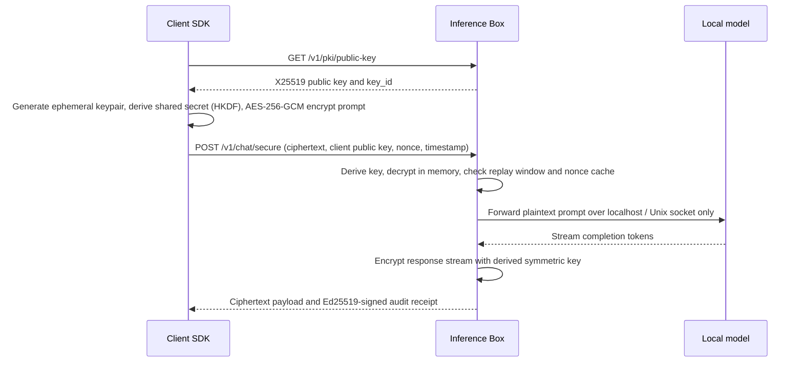

# Secure Inference Box

Application-layer end-to-end encryption in front of a locally hosted LLM, with signed request receipts and tests that try to prove prompts never touch disk or logs.

> **Status:** planned. Design document, not yet built. This is a portfolio project, not a product. Checkboxes below are ticked only when the work is done and tested.

---

## 1. What It Is, and What It Isn't

| Threat | Covered |
|---|---|
| Network observer, or a TLS-terminating proxy (CDN, ingress gateway) reading prompts | **Yes.** Payloads are encrypted directly to the inference box's public key. |
| Prompts leaking into application stdout/stderr, centralized logs, or disk | **Yes.** Verified by an automated canary leak test suite. |
| Tampered or replayed requests | **Yes.** AEAD authentication plus nonce tracking and strict timestamp window. |
| Malicious host operator or cloud admin with root privileges | **No**, unless executed inside a hardware TEE with attestation (stretch goal). |
| Prompt injection, model hallucinations, or toxic output | Out of scope. |

*Disclaimer: Not claimed as formal regulatory compliance (RBI, GDPR, or HIPAA), audited cryptography, or turn-key production appliance. This is an engineering systems design demonstration.*

---

## 2. End-to-End Cryptographic Flow

---

## 3. Core Architectural Choices

* **Hybrid Encryption:** X25519 elliptic-curve key agreement, HKDF (HMAC-based Key Derivation Function), and AES-256-GCM. Uses vetted, maintained cryptographic libraries (`cryptography` in Python). Zero custom or untested cryptographic primitives.
* **Fresh Ephemeral Keys per Request:** The client generates an ephemeral keypair for every request, guaranteeing forward secrecy. The box rotates its own receiving key on a strict periodic schedule.
* **Signed Audit Receipts:** An Ed25519-signed cryptographic record containing request ID, timestamp, ciphertext hash, model ID, and execution latency. A receipt proves a request was processed without revealing prompt contents. It does **not** prove data was not stored; that claim is guarded by the Canary Tests.
* **Model Runtime Isolation:** `llama.cpp` server with a lightweight GGUF model, bound strictly to `127.0.0.1` or a private Unix domain socket.
* **Data Ethics:** Synthetic prompts and test fixtures only. No proprietary, government, or real personal data.

---

## 4. Implementation Roadmap

- [ ] **Phase A (Base Inference Daemon):** `llama.cpp` server running behind a lightweight FastAPI gateway, fully containerized.
- [ ] **Phase B (E2EE Endpoint & Client SDK):** Client-side Python SDK implementing ephemeral key derivation; gateway decrypting strictly in ephemeral memory buffers.
- [ ] **Phase C (Receipt Verification):** Ed25519 asymmetric receipt signing and verification utilities.
- [ ] **Phase D (Automated Leak Testing):** Automated test harness executing canary scans (detailed below).
- [ ] **Phase E (Minimal Observability):** Telemetry tracking request counts, token latency, and error rates with strict redaction of payload fields.
- [ ] **Stretch Goal (Confidential Computing):** Packaging the container inside an **AWS Nitro Enclave** (CPU-only) with client-verified cryptographic attestation.

---

## 5. Automated Verification Tests

| Test | Objective | Pass Condition |
|---|---|---|
| **Canary Leak Test** | Prove prompts never touch persistent storage | A unique cryptographic canary string (e.g., `CANARY_HEX_98471`) sent as an encrypted prompt appears in **no log file (`/var/log`), stdout, stderr, temporary directory, or memory dump**. |
| **Ciphertext Tamper Test** | Verify integrity protections | A ciphertext payload modified by even 1 bit is immediately rejected with HTTP 400 AEAD authentication failure. |
| **Replay Attack Test** | Prevent duplicate execution | A request resubmitted with a reused nonce or expired timestamp window is dropped immediately. |
| **Key Mismatch Test** | Enforce key hygiene | A payload encrypted to an expired or invalid `key_id` fails cleanly without decrypting. |

---

## 6. Measurements & Benchmarks

| Metric | Target | Measured Result |
|---|---|---|
| **E2EE Handshake Overhead** | Latency delta vs raw plaintext endpoint (P50 / P95) | *Pending Phase 6 Build* |
| **Symmetric Decryption Latency** | Memory processing time per 1k input tokens | *Pending Phase 6 Build* |
| **Throughput Impact** | Tokens per second under encryption vs unencrypted baseline | *Pending Phase 6 Build* |

---

## 7. Known Limits & Boundaries

* **The Root Administrator Problem:** Without a hardware-enforced Trusted Execution Environment (TEE) like AWS Nitro Enclaves, an operator with root access can inspect process memory. The README explicitly documents this threat boundary.
* **OS Leak Vectors:** OS swap space, crash dumps, and unbuffered logging frameworks can leak data. The automated canary test is the enforcement mechanism, and findings will be reported honestly.
* **CPU Inference Scale:** Because this is an architectural security prototype, it focuses on cryptographic correctness and zero-leakage guarantees rather than maximum GPU throughput.
