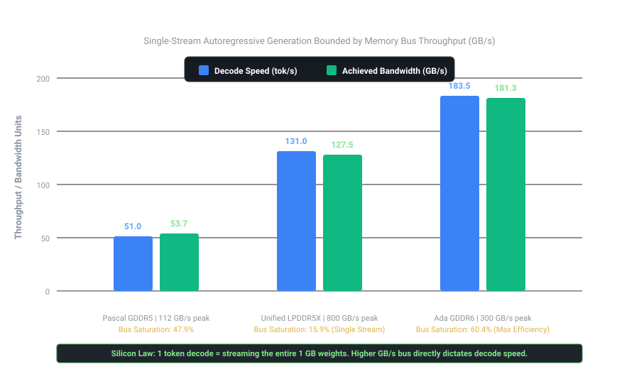

# Stage 01: Baseline Inference Profiling Report

## 1. Executive Summary & Fleet Comparison

We measured single-stream inference for `Qwen2.5-Coder-1.5B` (~986 MB model weights) across three physical hardware architectures: an edge consumer GPU (GTX 1050 Ti), a cloud enterprise GPU (NVIDIA L4), and a high-end unified memory workstation (Apple Mac Studio M3 Ultra).

Here is the complete comparison:

<p align="center">
  
</p>

| Metric | Node 1: GTX 1050 Ti | Node 3: NVIDIA L4 (Local) | Node 3: NVIDIA L4 (Tailscale) | Node 2: Mac Studio M3 Ultra |
| :--- | :--- | :--- | :--- | :--- |
| **Silicon Architecture** | Pascal GDDR5 (PCIe 3.0) | Ada GDDR6 (PCIe 4.0) | Ada GDDR6 (over WAN mesh) | Apple UMA LPDDR5X (Unified) |
| **Theoretical Peak BW** | 112.0 GB/s | 300.0 GB/s | 300.0 GB/s | 800.0 GB/s |
| **Time-to-First-Token (TTFT)** | 104.3 ms | **7.7 ms** | **147.5 ms** | **15.1 ms** (warm) / 861.7 ms (cold) |
| **Time-Per-Output-Token (TPOT)**| 19.6 ms/tok | **5.5 ms/tok** | **5.1 ms/tok** | **7.6 ms/tok** |
| **Decode Generation Speed** | 51.0 tok/s | **183.5 tok/s** | **197.2 tok/s** | **131.0 tok/s** (Avg: 129.4 tok/s) |
| **Achieved Memory Bandwidth** | 53.7 GB/s | **181.26 GB/s** | **192.01 GB/s** | **127.54 GB/s** |
| **Memory Bus Saturation (B=1)** | **47.9%** | **60.4%** | **64.0%** | **15.9%** (32.2% at B=8) |

---

## 2. The Two Phases of LLM Inference: Why the Math Changes

An LLM does not write a response all at once. It executes in two fundamentally different phases:

```
Phase 1: Prefill (Reading your prompt)
[ Prompt Tokens ] ──▶ Processed ALL AT ONCE in parallel ──▶ Compute-Bound (TFLOPS)
                      Determines TTFT (Time-To-First-Token)

Phase 2: Decode (Writing the answer)
[ Token 1 ] ──▶ [ Token 2 ] ──▶ [ Token 3 ] ... (One at a time) ──▶ Memory-Bandwidth Bound (GB/s)
                      Determines TPOT (Time-Per-Output-Token)
```

1. **Prefill Phase (TTFT):** The model reads your entire prompt (e.g. 49 tokens) in a single matrix-matrix multiplication (GEMM). Because all prompt tokens are known in advance, the GPU processes them in parallel. This phase is limited by how much compute math (TFLOPS) the chip can perform.
2. **Decode Phase (TPOT):** The model generates words one token at a time. It cannot generate token #5 until token #4 is finished. For **every single token**, the GPU must stream the entire 1 GB model weights from memory into the compute cores, perform a small vector multiplication (GEMV), and output one token. This phase is strictly limited by how fast memory can deliver data (GB/s).

---

## 3. Two Deep Engineering Discoveries

### Discovery 1: The Network Latency Mirage (7.7 ms vs 147.5 ms)
When testing the cloud NVIDIA L4 pod, we ran the benchmark under two network topologies:
1. **Local Loopback (Inside the pod, 0 ms wire):** TTFT was **7.7 ms**.
2. **Distributed Mesh (Over Tailscale from laptop to cloud pod):** TTFT was **147.5 ms**.

```text
Local Silicon Prefill Compute:       7.7 ms  ( 5.2% of wait time)
Tailscale WAN Network Transport:   139.8 ms  (94.8% of wait time)
-----------------------------------------------------------------
Total Client-Perceived TTFT:       147.5 ms
```

**Key Takeaway:** When a user queries a remote LLM API, **over 94% of the time spent waiting for the first word is pure internet round-trip ping**, not the model thinking. 

**However, streaming is immune to network distance:** Notice that while TTFT jumped by 140 ms, the token writing speed was nearly identical: **5.5 ms per token locally** vs **5.1 ms per token over Tailscale**. Once Server-Sent Events (SSE) open a streaming TCP connection, tokens flow continuously without waiting for back-and-forth round trips.

---

### Discovery 2: The Bandwidth Saturation Paradox (60.4% vs 15.9%)
* The **NVIDIA L4** achieved **60.4% bus saturation** ($181.26\ \mathrm{GB/s}$ of its 300 GB/s bus).
* The **Mac Studio M3 Ultra** achieved **15.9% bus saturation** ($127.54\ \mathrm{GB/s}$ of its 800 GB/s bus) at single-stream $B = 1$.

**Why did the high-end 800 GB/s Mac Studio saturate only 15.9% of its memory bus at B = 1?**
The answer lies in **GPU core occupancy**:
* `Qwen2.5-Coder-1.5B` is a compact model with a narrow hidden layer dimension ($d_{\mathrm{model}} = 1536$).
* At single-token generation ($\mathrm{batch\ size} = 1$), a narrow matrix-vector multiplication does not generate enough concurrent thread blocks to keep all 80 GPU cores on the M3 Ultra busy. The execution units spend idle cycles waiting between layer dispatches.
* In contrast, the NVIDIA L4 has 58 compact Streaming Multiprocessors and a large 48 MB on-chip L2 cache, which keeps the memory pipeline continuously full even on small models.
* **Continuous Batching Solves Occupancy:** When we scaled concurrency to $B = 8$ in Stage 03, aggregate decode throughput surged to **$262.01\ \text{tok/s}$**, pushing achieved memory bandwidth to **$258.34\ \mathrm{GB/s}$** ($32.3\%$ bus saturation).
* On a large 70B parameter model ($d_{\mathrm{model}} = 8192$), each layer is wide enough to saturate all 80 cores on the Mac even at $B = 1$, driving bus utilization above 70%.

---

## 4. How to Replicate These Numbers

To run these exact tests yourself, follow the copy-paste commands in the [Stage 01 README](README.md).

```bash
# To test Node 3 locally on the pod:
python3 benchmark_baseline.py \
  --endpoint http://127.0.0.1:8080/v1/chat/completions \
  --model Qwen2.5-Coder-1.5B \
  --samples 5 \
  --model-size-gb 0.986 \
  --peak-bandwidth-gbps 300.0

# To test Node 2 locally on Apple Mac Studio M3 Ultra:
python3 benchmark_baseline.py \
  --endpoint http://127.0.0.1:8080/v1/chat/completions \
  --model Qwen2.5-Coder-1.5B \
  --samples 5 \
  --model-size-gb 0.986 \
  --peak-bandwidth-gbps 800.0
```
